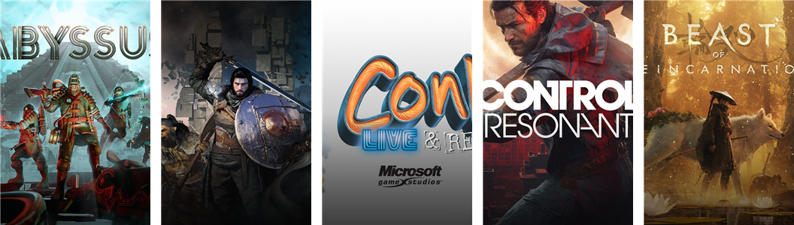
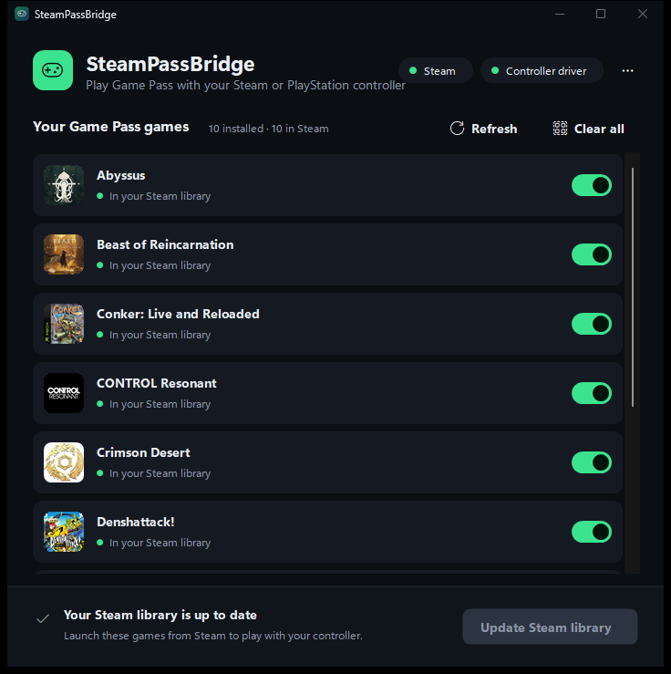
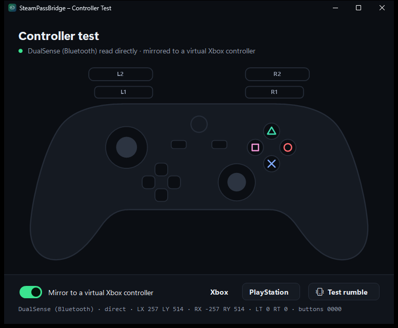

# SteamPassBridge

Play **Xbox Game Pass / Microsoft Store PC games** with a **Steam Controller**, **DualSense**, **DualShock 4**, or any
other controller Steam Input supports. Each controller shows up in the game as a normal Xbox controller, and the games
get proper cover art in your Steam library.

Windows only lets Game Pass (GDK) games see controllers through Steam Input if Steam launched them — which it can't do
for these sandboxed games. SteamPassBridge bridges the gap: it adds each game to Steam, feeds your controller in as a
virtual Xbox 360 pad, and (for PlayStation controllers) reads them directly so they keep working even while the game
has focus.

> **Not affiliated with Valve or Microsoft.** Independent hobby project. Steam and Xbox Game Pass are trademarks of their
> respective owners.

## Screenshots

Full-bleed Steam library artwork, generated automatically from each game's own packaged art:



| Add games to Steam | Controller test |
|---|---|
|  |  |

## Features

- **All your controllers in Game Pass games** — Steam Controller, DualSense, DualShock 4, and anything else Steam Input
  handles, each seen by the game as an Xbox 360 controller.
- **Direct PlayStation support** — DualSense / DualShock 4 are read straight from HID (USB or Bluetooth), so they don't
  suffer Steam's desktop-config switching. Full buttons, sticks, triggers, **rumble**, a **per-player lightbar colour**
  and the **player-number LEDs**.
- **Local co-op** — several controllers at once, each its own Xbox pad, hot-plugged as they connect.
- **Automatic Steam artwork** — every added game gets a full-bleed capsule, a hero banner and an icon, generated offline
  from the game's own packaged art. No internet, no SteamGridDB key.
- **Bundled driver** — the ViGEmBus controller driver is embedded and installed on request behind one Windows prompt.
- **Per-user install, clean uninstall** — no admin rights; removes cleanly and keeps a backup of your Steam shortcuts.
- **Controller Test** — a built-in screen to confirm every button, stick, trigger and rumble, with PlayStation symbols.

## Requirements

- Windows 10 or 11, 64-bit
- [Steam](https://store.steampowered.com/about/) (installed and signed in once)
- A Game Pass PC / Microsoft Store game, installed from the Xbox app
- Everything else (the ViGEmBus driver) is included.

## Install

1. Download `SteamPassBridge-x.y.z.zip` from the [Releases](../../releases) page, extract it, and run **SteamPassBridge.exe**.
2. Choose **Yes** to install. It copies itself to `%LOCALAPPDATA%\Programs\SteamPassBridge`, adds a Start-menu entry, and
   registers in *Installed apps* — no administrator rights. You can delete the download afterwards.
3. Choose **Yes** to install the controller driver when asked. It's bundled; Windows asks for permission once. (Skipped
   if you already have ViGEmBus, e.g. from DS4Windows. If it asks to restart Windows, do so once.)
4. Tick the Game Pass games you want and press **Save to Steam**. Steam closes and reopens.
5. Start the games **from your Steam library**. Customise the controller layout per game in Steam as usual.

> **SmartScreen warning:** because the app isn't code-signed, Windows may say it's unrecognised. Click
> **More info → Run anyway**. The full source is in this repository, and you can build it yourself (below).

## PlayStation controllers (DualSense, DualShock 4)

These are read directly over HID and turned into an Xbox controller, so they are **not** affected by Steam switching to
its desktop configuration when a game has focus — the problem that otherwise leaves a bridged controller dead inside a
running game. Each controller also gets a distinct lightbar colour with the player dots lit (player 1 blue, 2 red,
3 green, 4 purple).

1. Connect the controller by USB or Bluetooth.
2. In **Steam → Settings → Controller**, set **PlayStation Controller Support** to **Off**. SteamPassBridge reads the
   controller directly, so Steam doesn't need to — and leaving it on makes Steam create a second, dead copy of the pad
   inside the game.
3. Launch the game from Steam. Controllers switched on after the game starts are picked up automatically.

Not passed through (games only see an Xbox controller): the touchpad, adaptive triggers, motion/gyro and the speaker.

If a game already supports PlayStation controllers natively, launch it normally instead of through SteamPassBridge, so
it isn't seen twice.

## Uninstall

*Settings → Apps → Installed apps → SteamPassBridge → Uninstall*, or the **Uninstall** link in the app. This also
removes the games it added to Steam. Your original shortcuts file is kept as `shortcuts.vdf.spb-backup`. The ViGEmBus
driver is left installed in case other apps use it; remove **ViGEm Bus Driver** from *Installed apps* if you want it gone.

## Troubleshooting

- **Controller does nothing in game:** launch the game from **Steam**, not the Xbox app, and turn the controller on.
  Open **SteamPassBridge Controller Test** from your Steam library to see exactly what's detected.
- **A PlayStation controller shows up twice, or the game responds to a "dead" controller:** Steam is making its own copy
  as well. Set **PlayStation Controller Support** to **Off** (Steam → Settings → Controller).
- **An Xbox controller acts twice / controls two players:** turn off *Enable Steam Input for Xbox controllers*
  (Steam → Settings → Controller).
- **Mouse/keyboard behaviour instead of gamepad** (Steam Controller): in the game's Steam properties, keep *Use desktop
  configuration in launchers* off (SteamPassBridge sets this). PlayStation controllers avoid this entirely.
- **Library art didn't change:** restart Steam, or run `SteamPassBridge art` and restart Steam.
- **Log file:** `%LOCALAPPDATA%\Programs\SteamPassBridge\SteamPassBridge.log`.

## How it works

Steam Input only exposes a controller as a gamepad **inside processes Steam launched** (it injects
`gameoverlayrenderer64.dll` and presents a "Steam Virtual Gamepad"). Game Pass games are sandboxed packages started by
Windows, so they never see it, and adding `gamelaunchhelper.exe` to Steam fails because it exits immediately.

SteamPassBridge adds each game to Steam as a shortcut that runs `SteamPassBridge.exe launch <package>`. Because Steam
launches it, Steam Input feeds the controller into it. The tool mirrors that input onto a virtual Xbox 360 controller
(ViGEmBus, ~1 ms polling) that the whole system can see, sends the game's rumble back, starts the game through Windows,
and stays alive until the game fully exits so Steam keeps the game layout active. The virtual pad disappears when the
tool exits, even on a crash.

**PlayStation controllers take a more direct path.** Steam keeps a controller in its game layout only while the game's
own window is focused; a Game Pass window isn't Steam's, so Steam reverts to the desktop (mouse/keyboard) layout and the
bridged pad goes dead. SteamPassBridge instead reads DualSense / DualShock 4 controllers itself from HID, parses their
reports, and drives the virtual Xbox pad from that — no Steam Input in the loop, so focus doesn't matter. Rumble and the
lightbar are written back over the same HID channel (with the Bluetooth CRC when needed). A Steam Input slot that turns
out to be the same physical PlayStation pad is suppressed, so a controller is never bridged twice.

**Artwork** is generated from each game's packaged art (`MicrosoftGame.config` splash and logos) into Steam's
`userdata\<id>\config\grid` folder, keyed by the shortcut's app id — the same scheme SteamGridDB tools use.

### Command line

```
SteamPassBridge list                    list installed Game Pass games
SteamPassBridge sync [family...]         add games to Steam (all if none given); restarts Steam
SteamPassBridge art                      regenerate Steam library artwork for the added games
SteamPassBridge launch <family>          used by the Steam shortcuts: bridge controllers + run the game
SteamPassBridge test                     the Controller Test window
SteamPassBridge install                  install for this Windows user
SteamPassBridge install-driver           install the bundled ViGEmBus driver
SteamPassBridge uninstall [/quiet]       remove the app and its Steam shortcuts
```

## Building from source

No SDK or Visual Studio needed — it builds with the C# compiler that ships with the .NET Framework 4.x on every
Windows machine.

```
build.cmd      -> bin\SteamPassBridge.exe
release.cmd    -> dist\SteamPassBridge-<version>.zip (+ .sha256)
```

On first build, `tools\fetch-vigem.ps1` downloads the signed ViGEmBus 1.22.0 installer into `vendor\` and verifies its
SHA-256 and Authenticode signature; `build.cmd` embeds it as a resource. The version comes from `src\AssemblyInfo.cs`.

Pushing a `v*` tag (e.g. `v1.6.1`) runs `.github/workflows/release.yml`, which builds on a clean Windows runner and
publishes the zip to a GitHub Release.

Handy environment variables for development: `SPB_THEME=light|dark` forces a theme, `SPB_OFFSCREEN=1` opens windows
off-screen without taking focus, and `SPB_SANDBOX=<folder>` redirects every Steam/install change into that folder for
safe testing.

### Source layout

| Area | Files |
|------|-------|
| Entry point, CLI, game launch | `src/Program.cs` |
| Game Pass discovery & artwork sources | `src/Games.cs` |
| Steam shortcuts (binary VDF) & grid folders | `src/Steam.cs`, `src/Vdf.cs` |
| Controller bridging | `src/Bridge.cs`, `src/XInput.cs`, `src/ViGEm.cs` |
| Direct PlayStation HID | `src/Hid.cs`, `src/DualShock.cs`, `src/Controllers.cs` |
| Steam library artwork | `src/Artwork.cs` |
| Install / uninstall / driver | `src/Setup.cs`, `src/DriverSetup.cs` |
| UI | `src/UI/*.cs` |

## License

MIT — see [LICENSE](LICENSE). SteamPassBridge is an independent project, not affiliated with or endorsed by Valve or
Microsoft. Steam and Xbox Game Pass are trademarks of their respective owners. It bundles the **ViGEmBus** driver, a
separate BSD-3-Clause project by Nefarius Software Solutions e.U. — see [THIRD-PARTY-NOTICES.txt](THIRD-PARTY-NOTICES.txt).
